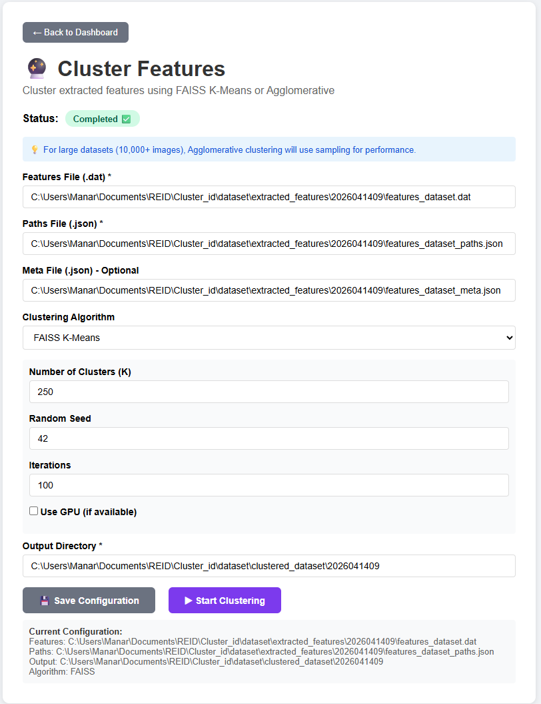

# 🏷️ ReID Labeling Tool

A complete pipeline for **Person Re-Identification (ReID)** dataset labeling with a clean web interface. Extract features, cluster images, and label them efficiently.

---

## 📋 Table of Contents

- [Features](#-features)
- [Quick Start](#-quick-start)
- [Workflow](#-workflow)
- [Project Structure](#-project-structure)
- [Configuration](#-configuration)
- [Dependencies](#-dependencies)
- [Similarity Search](#-similarity-search)
- [Export Labels](#-export-labels)
- [Customization](#-customization)
- [Troubleshooting](#-troubleshooting)
- [License](#-license)
- [Contributing](#-contributing)

---

## ✨ Features

- **3-Step Workflow Dashboard** - Extract → Cluster → Label
- **Feature Extraction** - Uses OSNet ONNX models with batch processing
- **Clustering** - FAISS K-Means & Agglomerative Clustering
- **Interactive Labeling** - Drag & drop, merge, split, and similarity search
- **Real-time Progress** - Live updates for extraction and clustering
- **Export Labels** - JSON format for easy integration
- **GPU Support** - Optional GPU acceleration for FAISS
- **Large Dataset Handling** - Sampling for datasets >10,000 images

---

## 🚀 Quick Start

### Prerequisites

```bash
# Clone the repository
git clone https://github.com//reid-labeling-tool.git
cd reid-labeling-tool

# Install dependencies
pip install -r requirements.txt


# to run the dashboard
python .\reid_labeling_tool\app.py

🌐 Dashboard: http://localhost:5000/dashboard

🌐 Labeling: http://localhost:5000/

```



